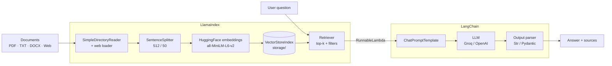

# 📄 RAG-Based Intelligent Document Assistant

**Assignment 1.2 · LangChain + LlamaIndex**

Ask questions about your own documents (PDF, TXT, MD, DOCX and web pages) and get accurate answers that cite their sources. The assistant uses **Retrieval-Augmented Generation (RAG)**: **LlamaIndex** finds the most relevant parts of your documents and **LangChain** turns them into an answer with an LLM.

🔗 **Live app:** `https://<your-app-name>.streamlit.app` *(replace with your Streamlit Cloud link)*

---

## ✨ Features

| Feature | What it does |
|---|---|
| 📥 **Document ingestion** | Loads PDF, TXT, MD and DOCX files from `data/`, plus any web page URL |
| 🗂️ **Vector index** | Splits documents into chunks, creates embeddings and saves the index to `storage/` |
| 🔎 **Semantic retrieval** | Finds the most similar chunks to your question (top-k, adjustable 1–10) |
| 💬 **Grounded answers** | Answers only from your documents and cites sources like `[Source 1]` |
| 🚫 **No hallucination** | If the answer is not in the documents, it says so instead of guessing |
| 🧾 **Structured answers** | Optional mode with answer, sources, confidence and follow-up questions (Pydantic) |
| 📚 **Multi-document search** | Search all documents or only the ones you select |
| ⚖️ **Document comparison** | Compares two or more documents on the same question |
| 📝 **Summarization** | Map-reduce summary of a whole document, even long ones |
| 🔁 **Follow-up questions** | Remembers the chat, so *"and on which days?"* is understood in context |

---

## 🏗️ Architecture



### Who does what (assignment constraints)

| Framework | Used for |
|---|---|
| **LlamaIndex** | Document loading (`SimpleDirectoryReader`), chunking (`SentenceSplitter`), embeddings, `VectorStoreIndex`, persistence, retriever with metadata filters |
| **LangChain** | LLM integration (`ChatGroq` / `ChatOpenAI`), prompt templates (`ChatPromptTemplate`), LCEL chains and runnables (`RunnableLambda`, `RunnablePassthrough`), output parsing (`StrOutputParser`, `PydanticOutputParser`) |

The two frameworks are connected by wrapping the LlamaIndex retriever in a LangChain `RunnableLambda`, so retrieval becomes one step of the LCEL chain:

```python
chain = (
    {"context": make_context_runnable(retriever),   # LlamaIndex retrieval
     "question": RunnablePassthrough()}
    | qa_prompt
    | llm
    | StrOutputParser()
)
```

---

## 🧰 Tech Stack

| Layer | Technology |
|---|---|
| LLM | Groq `openai/gpt-oss-20b` (default) · OpenAI `gpt-4o-mini` (optional) |
| Embeddings | `sentence-transformers/all-MiniLM-L6-v2` (runs locally, free, 384 dimensions) |
| Indexing / retrieval | `llama-index-core`, `llama-index-embeddings-huggingface`, `llama-index-readers-file` |
| Orchestration | `langchain-core`, `langchain-groq`, `langchain-openai` |
| Web pages | `requests` + `BeautifulSoup` |
| UI / deployment | Streamlit → Streamlit Community Cloud |
| Development | VS Code + Jupyter notebook |

---

## 📁 Project Structure

```
├── rag_document_assistant.py      # Deployable Streamlit app (Steps 1-14 + UI)
├── RAG_Document_Assistant.ipynb   # Step-by-step notebook (same code, with tests after each step)
├── RAG_Document_Assistant.pptx    # Project presentation
├── requirements.txt               # Python packages
├── .gitignore                     # Keeps .env, virtual environments and caches out of GitHub
├── data/                          # Your documents (PDF / TXT / MD / DOCX)
└── storage/                       # Saved vector index (created automatically)
```

---

## 🚀 Run Locally (VS Code)

**1. Clone the repository and create a virtual environment**

```bash
git clone <repo-url>
cd <repo-folder>
python -m venv .venv
.venv\Scripts\activate          # Windows
# source .venv/bin/activate     # macOS / Linux
```

**2. Install the packages**

```bash
python -m pip install -r requirements.txt
```

> Use `python -m pip` (not just `pip`) so the packages go into the virtual environment.

**3. Add your API key** – create a `.env` file in the project folder:

```
LLM_PROVIDER=groq
GROQ_API_KEY=your_groq_api_key

# Optional - only if LLM_PROVIDER=openai
OPENAI_API_KEY=your_openai_api_key
```

**4. Add documents** to the `data/` folder (or upload them later in the app).

**5. Run**

| Option | Command / action |
|---|---|
| Web app | `streamlit run rag_document_assistant.py` → opens at `http://localhost:8501` |
| Notebook | Open `RAG_Document_Assistant.ipynb` in VS Code, select the `.venv` kernel, click **Run All** |

> The first run downloads the embedding model (~90 MB). After that the index is loaded from `storage/` and is only rebuilt when your documents change.

---

## ☁️ Deploy on Streamlit Community Cloud

1. Push the project to GitHub (the `.env` file is excluded by `.gitignore`):
   ```bash
   git add .
   git commit -m "RAG Document Assistant"
   git push origin main
   ```
2. Go to [share.streamlit.io](https://share.streamlit.io), sign in with GitHub and click **New app**.
3. Select the repository, branch `main` and main file `rag_document_assistant.py`.
4. Open **Advanced settings → Secrets** and add:
   ```toml
   GROQ_API_KEY = "your_groq_api_key"
   LLM_PROVIDER = "groq"
   ```
5. Click **Deploy**. Every new push to `main` redeploys the app automatically.

**Notes for the cloud version**
- Files uploaded in the app are lost when the app restarts. Keep permanent documents in the `data/` folder in GitHub.
- Free apps go to sleep after 12 hours without visitors. Open the link and click **"Yes, get this app back up!"** to wake it.
- The first deployment takes a few minutes because PyTorch is installed for the embedding model.

---

## 🖥️ Using the App

| Area | How to use it |
|---|---|
| **Sidebar** | Upload documents, add a web URL, set *Chunks to retrieve (top-k)*, switch on *Structured answers*, rebuild the index |
| **💬 Ask questions** | Type a question. Use *Search in* to limit the search to selected documents. Open **Sources** under an answer to see the exact text used |
| **⚖️ Compare documents** | Pick two or more documents and enter one question |
| **📝 Summarize** | Pick a document and click **Summarize** (long documents are summarized part by part) |

**Example questions** (with the sample policy documents):

- *What is the price tolerance for three-way match?* → 2% or 50 EUR, whichever is lower
- *On which days are payment runs executed?* → Tuesday and Thursday
- *What is the standard payment term?* → then *And can it be paid earlier?* (follow-up)
- *Who won the IPL 2026?* → "I could not find this information in the provided documents."

---

## ⚙️ Configuration

All settings are in **Step 2** of `rag_document_assistant.py`:

| Setting | Default | Meaning |
|---|---|---|
| `CHUNK_SIZE` / `CHUNK_OVERLAP` | 512 / 50 | Chunk size and overlap in tokens |
| `TOP_K` | 4 | Number of chunks retrieved per question |
| `MAX_CHARS_PER_CALL` | 6000 | Text sent per LLM call when summarizing |
| `MAX_OUTPUT_TOKENS` | 2048 | Maximum length of each LLM answer |
| `RATE_LIMIT_RETRIES` / `RATE_LIMIT_WAIT_SECONDS` | 4 / 30 | Retries after a rate-limit error |
| `GROQ_MODEL` | `openai/gpt-oss-20b` | Groq model used for answers |
| `EMBED_MODEL_NAME` | `all-MiniLM-L6-v2` | Embedding model |
| `INDEX_VERSION` | 2 | Increase to force a full index rebuild |

---

## 🧩 How the Code Is Organised

| Step | Purpose |
|---|---|
| 1–2 | Imports, `.env` keys and configuration |
| 3 | LangChain LLM (`ChatGroq` / `ChatOpenAI`) + rate-limit retry helper |
| 4 | LlamaIndex settings: embedding model and `SentenceSplitter` |
| 5 | Document ingestion: local files and web pages |
| 6 | Build or load the `VectorStoreIndex` (fingerprint detects changed documents) |
| 7 | Retriever with top-k and document filters |
| 8 | Bridge: LlamaIndex retriever → LangChain `RunnableLambda` |
| 9 | Prompt template with anti-hallucination rules |
| 10 | RAG chain using LCEL |
| 11 | Structured answers with `PydanticOutputParser` |
| 12 | Compare documents |
| 13 | Map-reduce summarization |
| 14 | Conversational RAG (rewrites follow-up questions) |
| 15 | Streamlit UI (only in the `.py` file) |

---

## 🛠️ Troubleshooting

| Problem | Cause | Fix |
|---|---|---|
| `Error code: 429` / `413` | Groq free-tier limit (tokens per minute or per day) | Wait a minute and retry. If the message says **tokens per day (TPD)**, wait for the reset or change `GROQ_MODEL` to another Groq model |
| Sources show `endobj`, `/FontDescriptor` | PDF reader package missing | `python -m pip install llama-index-readers-file pypdf` |
| `ModuleNotFoundError: llama_index` | Packages installed into the global Python instead of the venv | Activate `.venv` and use `python -m pip install ...` |
| `No documents to index` | `data/` is empty | Add files to `data/` or upload them in the app |
| App on Streamlit Cloud is asleep | No visitors for 12 hours | Open the link and click **"Yes, get this app back up!"** |

---

## 🔮 Possible Improvements

- OCR for scanned PDFs
- A hosted vector database (e.g. Chroma, Pinecone) so uploads survive restarts
- Automatic answer-quality evaluation
- Streaming answers word by word

---

## 👤 Author

**Akshay Kale** · Assignment 1.2 – RAG-Based Intelligent Document Assistant (LangChain + LlamaIndex)
